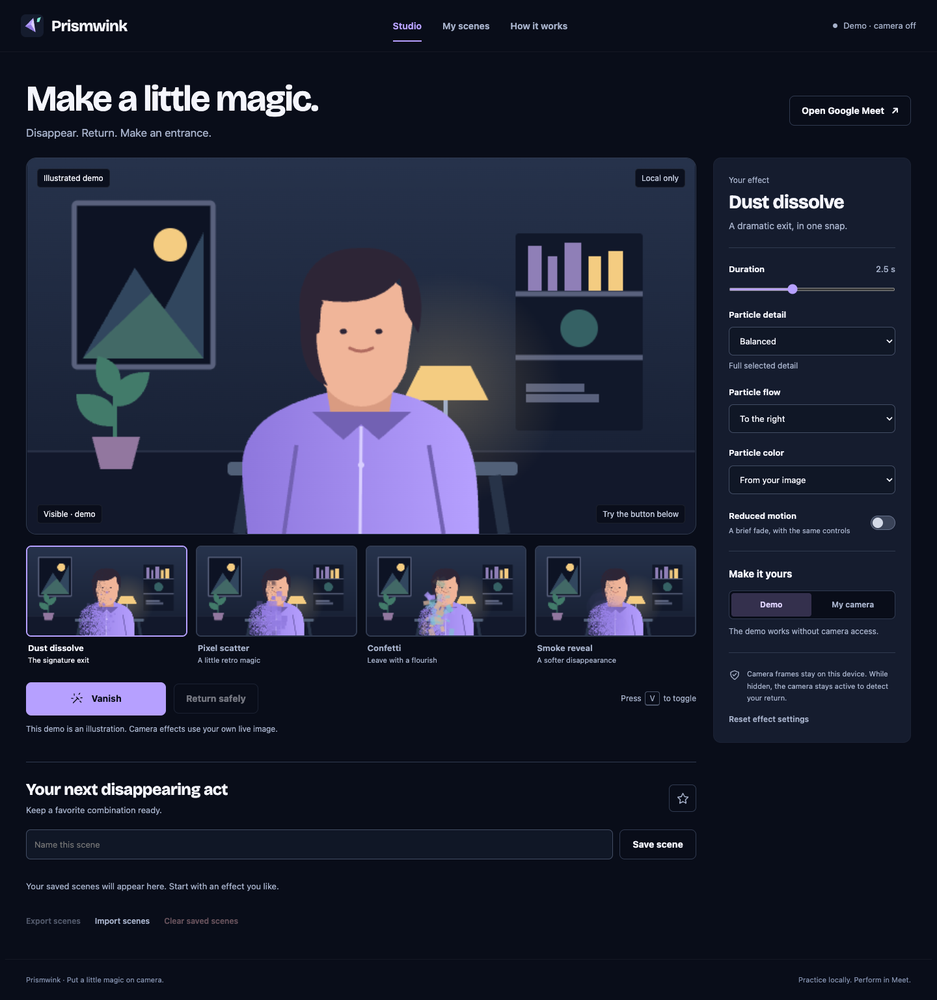

# Prismwink

Put a little magic on camera.

Prismwink is a Chrome extension with a built-in practice studio and a Google Meet camera adapter. A deliberate thumb-and-middle-finger pinch/release can dissolve your camera image into particles and mute your outgoing microphone. The return cue reconstructs the image and restores only microphone state the extension owns.

The source is TypeScript. Vite, the official React plugin and CRXJS build the Chrome extension; the studio and popup use React and React DOM. Camera rendering and hand processing run locally using packaged assets.

## Try it locally

1. Install Node.js 24 or newer and run `npm ci`.
2. Run `npm run check`.
3. Open `chrome://extensions`, enable Developer mode and choose **Load unpacked**.
4. Select this project's `dist` folder. Pin Prismwink and open **Practice studio**.
5. For Meet, reload the meeting tab after installing. Turn on the camera, capture the empty room while you step out of frame, return, and practice the gesture or use **Vanish & mute**.

The studio's illustrated Demo does not ask for camera permission. Camera mode requires an explicit action. The physical camera stays active while you are hidden so the extension can detect a return gesture. The room behind you is a still capture, not a live reconstruction.

If you receive a release ZIP, extract it first and choose the extracted folder with **Load unpacked**. Chrome does not load the ZIP directly. Keep the extracted folder in place while the extension is installed.

In the studio, press **V** to toggle an effect. In Meet, the default shortcut is **Alt+Shift+V**. Change it in `chrome://extensions/shortcuts` if another application uses that combination.

## Development commands

- `npm run typecheck`: strict TypeScript checks.
- `npm test`: deterministic gesture, rendering and lifecycle regression tests.
- `npm run build`: bundle the extension into `dist`.
- `npm run test:browser`: load the built extension in an isolated Chromium test profile and verify studio and outgoing media behavior.
- `npm run package`: archive the current `dist` build into `releases`.
- `npm run publish:package`: choose a version bump, validate, build and create a ZIP on your Desktop.

Use `npm run dev` for the Vite/CRXJS development build. Reload the Meet page after edits to the timing-sensitive camera hook.

For browser tests, run `npx playwright install chromium` once. Tests use fake camera/microphone devices and a local intercepted meeting harness; they do not sign in to a Google account.

## Create a release ZIP

Run `npm run publish:package` in an interactive terminal. Choose **patch** for fixes, **minor** for new features, or **major** for breaking changes; the prompt shows each resulting version. Entering `q` cancels.

The command updates `package.json` and the lockfile together, runs the type checks, unit tests, production build and browser checks, then creates `~/Desktop/Prismwink-vX.Y.Z.zip`. The manifest takes its version from the package. Existing ZIP files are never overwritten. Failed checks, cancellation or archive creation restore the original version files; rebuild before loading `dist` after a failed attempt.

Install the test browser first with `npx playwright install chromium`. Packaging requires the `zip` command, included with macOS and available on Linux. To choose another destination, run `npm run publish:package -- --output-dir /absolute/path`.

This command creates a local release archive. Store submission and Git commits/pushes remain separate actions.

## Current scope

Dust, pixel, confetti and smoke effects; configurable timing, particle detail and palette; a practice scene; camera setup and capture; deliberate gesture detection; manual/keyboard controls; favorites and recently used effects; saved scenes; automatic particle detail reduction; and explicit microphone/recovery status. See the [feature plan](docs/designs/camera-magic-studio.md) for launch, expansion and exploratory items. A planned feature is not a supported feature until implemented and verified.

Automated tests are distinct from a real receiving participant in Google Meet. A real meeting, background-tab behavior, hardware gesture accuracy and other camera extensions remain required manual release checks. Do not publish a store-ready claim based only on a successful local preview or test harness.

## Privacy

The extension does not upload camera frames, room captures, recordings or presets to an additional service. Google Meet receives the outgoing processed stream during a call. The extension is limited to `meet.google.com`; the studio is packaged with it. See [PRIVACY.md](PRIVACY.md).

The [visual system](DESIGN.md), [editable brand assets](public/assets/) and [implementation plan](docs/designs/camera-magic-studio.md) are kept in this repository. No purchased domain or separate hosted application is required.

## Store release preparation

The [publishing plan](store/PUBLISHING.md), [listing copy](store/listing.md), [reviewer instructions](store/reviewer-instructions.md), [privacy form notes](store/privacy-disclosures.md) and [artwork preview](store/preview.html) are included. Run `npm run store:assets` after building to refresh the eight-image pack from the actual product. This preparation does not mean the extension has passed store review or the outstanding live-call acceptance checks.
